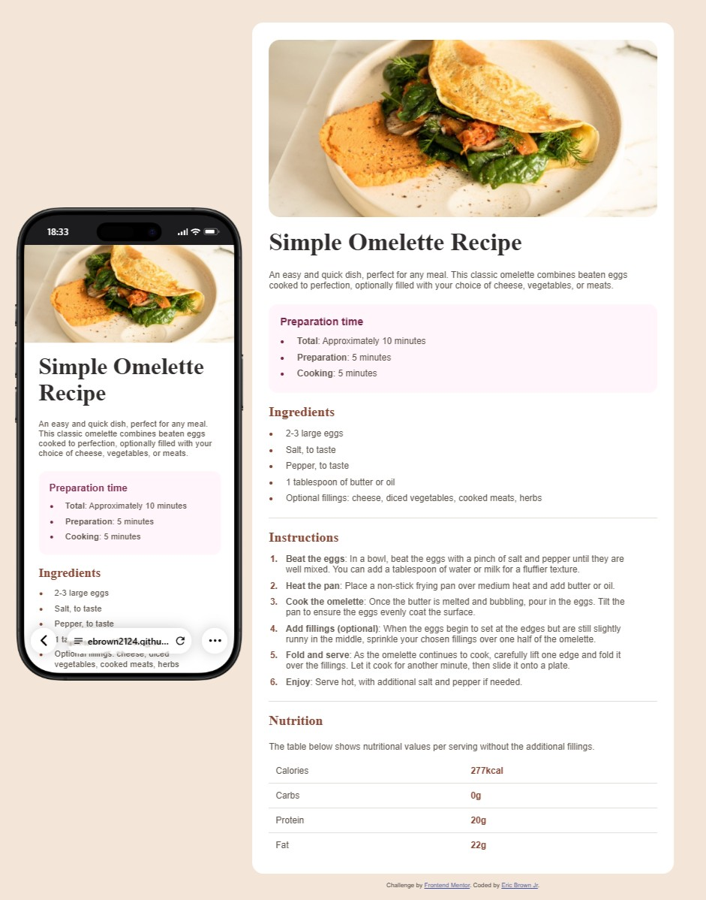

[Frontend Mentor](https://www.frontendmentor.io) projects provide by Frontend Mentor

In this project I used flexbox and table

while doing this project I realize did a lot of unnecessasry line of html and css code that that would of work in elment. Besides that, this project reinforce the basic of html and css, but I learn more how to style tables and style singler elemants like the dots, units of measurement, numbers

link to project

[project link](https://ebrown2124.github.io/recipe-page-main/)